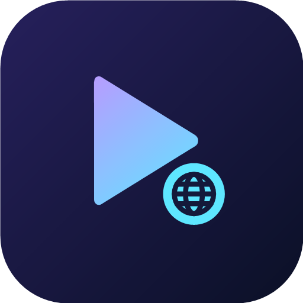

  

# mpvGo

A fast, battery-friendly Android video player powered by **libmpv**, with a built-in web browser
(planned): play web videos directly in mpv, download them, and browse with ad blocking.

## Status

Early development. Planned:

- Bug fixes (sorting crash, reliable resume position, and more)
- Lower battery use and a smaller APK
- Built-in browser: tap a video on a page to play it in mpv
- Optional downloads (HTTP/HLS) with a Downloads page
- Ad blocking in the browser

**Requirements:** Android 14 or newer, 64-bit ARM (arm64-v8a) devices only.

## Credits

mpvGo started as a fork of [mpvEx](https://github.com/marlboro-advance/mpvEx) by marlboro-advance
and is now developed independently. Thanks to its authors and to the projects it builds on:
[mpv-android](https://github.com/mpv-android/mpv-android) and
[mpvKt](https://github.com/abdallahmehiz/mpvKt). The original commit history is preserved in this
repository.

## License

Apache License 2.0 — see [LICENSE](LICENSE). Bundled native libraries (mpv, FFmpeg) are under their
own licenses (FFmpeg is built with GPLv3-enabled components).